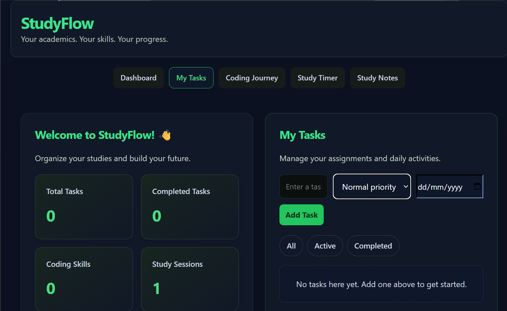

# StudyFlow

A study dashboard for students to manage tasks, track coding skills, run focus sessions and keep notes. Built with plain HTML, CSS and JavaScript, with no frameworks.

**Live demo:** https://fountainodin.github.io/StudyFlow/

## Features

- **Dashboard** with task, skill and session totals, a daily goal tracker and a 7-day activity chart
- **Tasks** with priority levels, due dates, overdue warnings and All / Active / Completed filters
- **Coding journey** to track skills with progress sliders
- **Study timer** with 15, 25, 45 or 50 minute sessions that keep running after a page refresh
- **Study notes** with inline editing, search and a subject filter
- **Backup and restore** your data as a file
- Responsive layout, keyboard-friendly controls and accessible labels

## How it works

All data is saved in your browser's `localStorage`, so there is no account or server. Use **Download Backup** regularly, because clearing your browser data removes your notes.

## What I learned

- Building and updating the page with DOM methods, using `textContent` instead of `innerHTML`
- Saving and loading data with `localStorage`, and handling corrupted data safely
- Keeping a timer accurate across refreshes by saving an end time
- Reading and writing files in the browser with `Blob` and `FileReader`
- Responsive CSS, design tokens with CSS variables and accessible forms

## Run it locally

1. Download or clone this repository.
2. Open `index.html` in your browser.

## Author

Fountain Odin, Software Engineering student at the University of Benin.